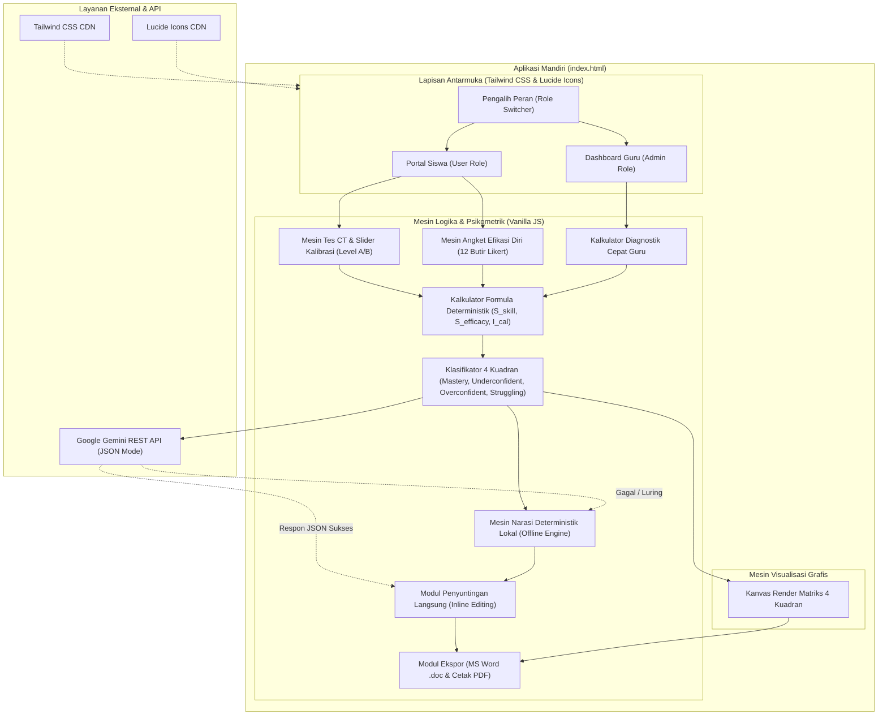
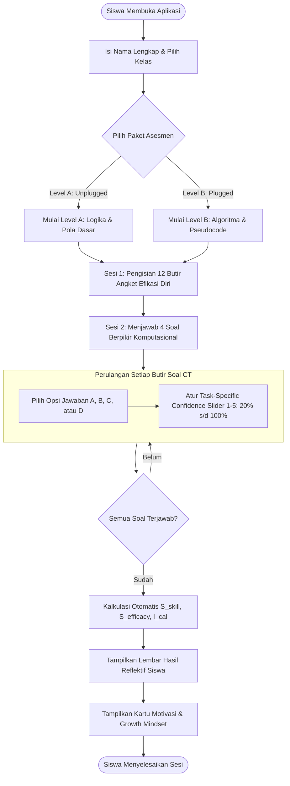
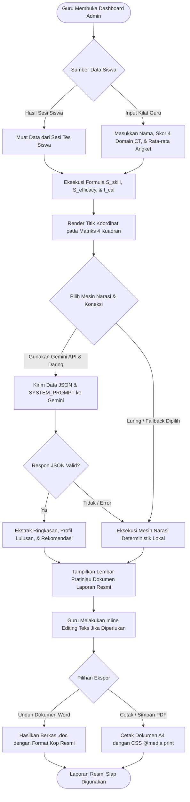
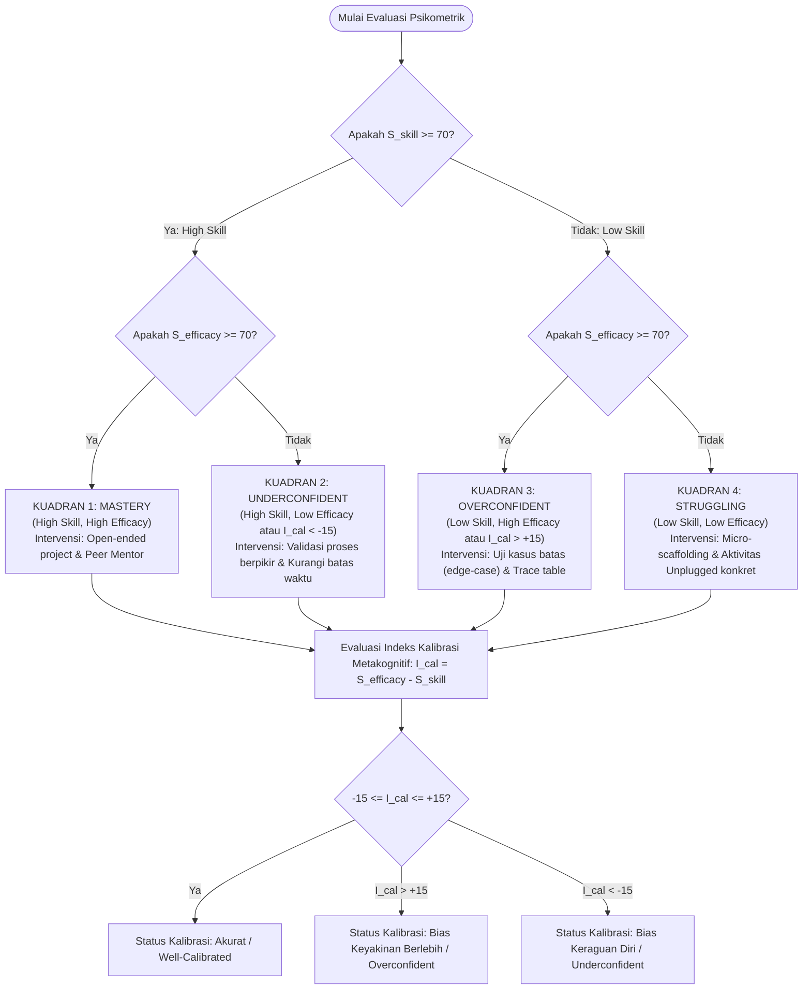
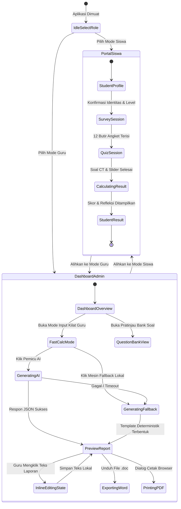
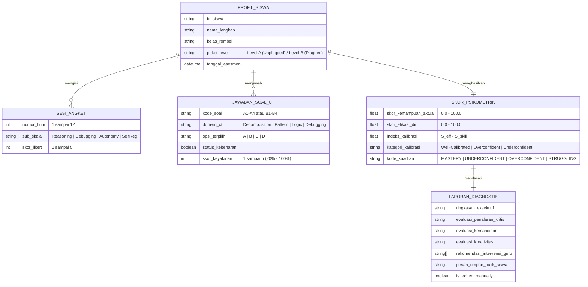
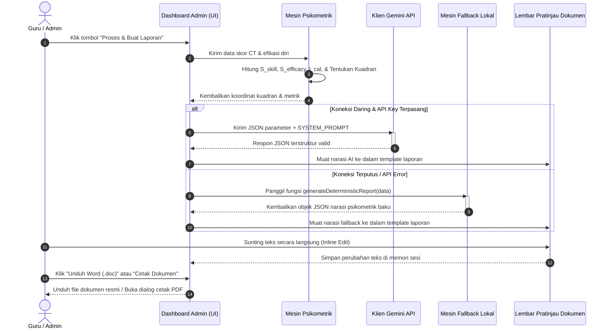

# DIAGRAM ARSITEKTUR & ALUR SISTEM (MERMAID.MD)
## PLATFORM EFIKODING: MODEL SISTEM, DATA, & LOGIKA KALIBRASI PSIKOMETRIK

**Versi Dokumen:** 1.0.0  
**Standar Diagram:** Mermaid.js Standard  

---

## 1. DIAGRAM ARSITEKTUR SISTEM (SYSTEM ARCHITECTURE)

Diagram berikut mengilustrasikan struktur arsitektur *Single-File Application* yang mandiri, menghubungkan dua peran antarmuka dengan modul komputasi psikometrik lokal dan mesin AI:

---

## 2. DIAGRAM ALUR PENGGUNA SISWA (STUDENT USER JOURNEY)

Alur pengerjaan kuis siswa dari *onboarding*, pengisian angket efikasi baku, pengerjaan soal CT dengan slider keyakinan per soal, hingga penerimaan kartu refleksi *growth mindset*:

---

## 3. DIAGRAM ALUR GURU & LOGIKA GENERATOR (ADMIN WORKFLOW)

Alur komprehensif bagi guru pengampu saat menggunakan dashboard split-screen, melakukan input cepat (*fast calculator*), memicu AI atau *fallback*, menyunting teks, dan mencetak dokumen:

---

## 4. POHON KEPUTUSAN KALIBRASI PSIKOMETRIK & 4 KUADRAN (DECISION TREE)

Logika deterministik yang menentukan kuadran dan strategi intervensi pedagogis:

---

## 5. DIAGRAM STATUS APLIKASI (STATE MACHINE)

Transisi status aplikasi selama sesi berlangsung:

---

## 6. DIAGRAM MODEL DATA & ENTITAS (ENTITY-RELATIONSHIP MODEL)

Struktur data internal yang dikelola di dalam memori lokal aplikasi:

---

## 7. DIAGRAM URUTAN GENERASI LAPORAN (SEQUENCE DIAGRAM)

Interaksi antar modul saat memproses narasi laporan diagnostik dengan jaminan *fallback*:

